<picture>
  <source media="(prefers-color-scheme: dark)" srcset="assets/banner-dark.svg">
  
</picture>

 

<picture>
  <source media="(prefers-color-scheme: dark)" srcset="assets/terminal-dark.svg">
  
</picture>

### Sobre mí

Estudio Negocios Digitales en la UM y desde hace un tiempo hago webs y sistemas para empresas uruguayas. Lo que más me gusta es agarrar algo que hoy se hace a mano o en un Excel y convertirlo en algo que funcione solo.

🇬🇧 Digital Business student in Montevideo, building websites, internal tools and AI assistants for small businesses.

### Stack

  

Algunos de mis proyectos están en [brunojorba.com/es/proyectos →](https://brunojorba.com/es/proyectos)

### Contacto

  <a href="https://brunojorba.com"><picture>
    <source media="(prefers-color-scheme: dark)" srcset="assets/contact-web-dark.svg">
    
  </picture></a>
  <a href="mailto:contact@brunojorba.com"><picture>
    <source media="(prefers-color-scheme: dark)" srcset="assets/contact-mail-dark.svg">
    
  </picture></a>
  <a href="https://www.linkedin.com/in/bruno-jorba-cabrera-a93760173"><picture>
    <source media="(prefers-color-scheme: dark)" srcset="assets/contact-linkedin-dark.svg">
    
  </picture></a>

 

